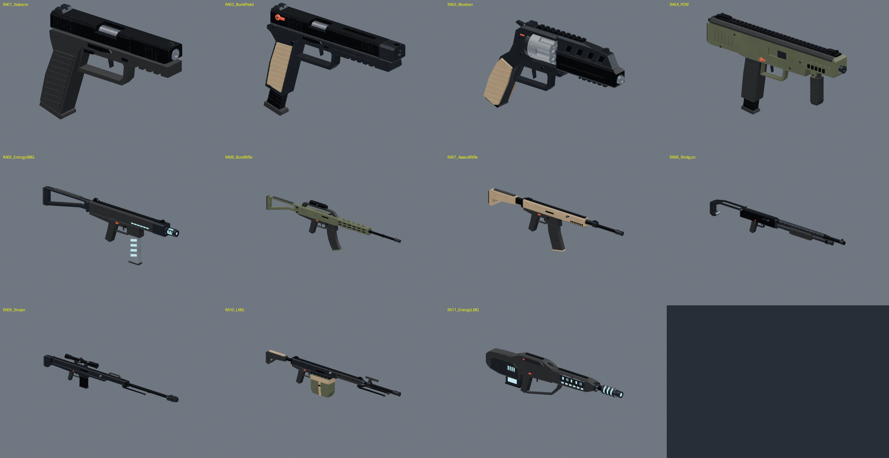

# Fusion FPS Guns

Autodesk Fusion のスクリプトで作った、FPSゲーム向けの銃の3Dモデル集です。P230風ピストルは、Three.js で操作できる展示サイトにしてあります。

**サイト:**

- P230: https://sskrc.github.io/fusion-fps-guns/
- ORBIS-V（変形する架空の銃・有機的なデザイン）: https://sskrc.github.io/fusion-fps-guns/orbis.html
- TALOS-IX（変形する架空の銃・機械的なデザイン）: https://sskrc.github.io/fusion-fps-guns/talos.html

すべて表示用のモデルです。銃身は中実で、薬室や撃発機構などの内部は作っていません。発砲はアニメーションと合成音による演出です。

## サイトの操作

| 操作 | キー |
|---|---|
| 発砲 | Space / F |
| マガジンを抜く・入れる | M |
| リロード | R |
| スライドを引く・戻す | S |
| デコック | D |
| 分解・組み立て | X |

ドラッグで回転、ホイールでズームできます。

## ORBIS-V の操作

| 操作 | キー |
|---|---|
| SEALED / LANCE / BLOOM に変形 | 1 / 2 / 3 |
| チャージして発射 | Space / F |

ORBIS-V は架空のオリジナルデザインです。変形の全フレームでパーツ同士の干渉がないことをスクリプトで確認しています。

## TALOS-IX の操作

| 操作 | キー |
|---|---|
| STOWED / RAIL / BREACH に変形 | 1 / 2 / 3 |
| チャージして発射 | Space / F |

TALOS-IX も架空のオリジナルデザインです。歯車、ピストン、放熱フィンを露出させ、砲身の2段伸縮、ストック、二脚、跳ね上げ式の側面装甲が動きます。ORBIS-V と同じく、変形の全フレームで干渉がないことを確認しています（ヒンジのピンは対象外）。

## RogueArena 武器セット（11丁）

FPSゲーム向けの架空の武器11種です。実在の銃からはシルエットの特徴だけを着想として借りた、オリジナルデザインです。ロゴや刻印はなく、銃身は中実で内部機構もありません。



| ID | 役割 | 可動部 |
|---|---|---|
| RA01_Sidearm | 標準ハンドガン | スライド、マガジン、トリガー |
| RA02_BurstPistol | バーストハンドガン | スライド、ハンマー、セレクター、延長マガジン |
| RA03_Revolver | 大型ハンドガン | シリンダーの回転と振り出し、ハンマー |
| RA04_PDW | 高速SMG | 伸縮ストック、折りたたみフォアグリップ、起倒式サイト |
| RA05_EnergySMG | エネルギーSMG | エネルギーセル、横折りストック、チャージハンドル |
| RA06_BurstRifle | バーストライフル | 横折りストック、セレクター、チャージハンドル |
| RA07_AssaultRifle | アサルトライフル | 伸縮ストック、起倒式サイト、チャージハンドル |
| RA08_Shotgun | ショットガン | ポンプ、上折りストック、装填口のフラップ |
| RA09_Sniper | スナイパーライフル | 後退する銃身、二脚、マガジン |
| RA10_LMG | 軽機関銃 | 横開きの給弾カバー、弾薬ポーチ、二脚、ストック |
| RA11_EnergyLMG | エネルギーLMG | 冷却フラップ、エネルギーセル、チャージハンドル |

各フォルダ（`models/RogueArena/<ID>`）に GLB / FBX と2Kテクスチャ（発光マップ付き）があります。アニメーションは `Idle` `Fire` `Reload` と、銃ごとの動作（ストック開閉、二脚展開、排熱など）で、全フレームで可動部の干渉がないことを確認しています（ヒンジのピンは対象外）。

## モデル

| モデル | 場所 | 内容 |
|---|---|---|
| P230風ピストル | `models/P230` | GLB / FBX、2Kテクスチャ、ボーン8本、アニメーション9種 |
| ORBIS-V 変形エミッター | `models/ORBIS` | GLB / FBX、2Kテクスチャ（発光マップ付き）、ボーン9本、変形・発射アニメーション11種 |
| TALOS-IX 変形レールエミッター | `models/TALOS` | GLB / FBX、2Kテクスチャ（発光マップ付き）、51パーツ、変形・発射アニメーション11種 |
| RogueArena 武器セット | `models/RogueArena` | 11丁。各 GLB / FBX、2Kテクスチャ、アニメーション5〜7種 |
| サブマシンガン VX-9 Wasp | `models/SMG_VX9_Wasp` | GLB / FBX（可動部なし） |
| ショットガン HR-12 Breaker | `models/Shotgun_HR12_Breaker` | GLB / FBX（可動部なし） |
| スナイパー LR-X Longshot | `models/Sniper_LRX_Longshot` | GLB / FBX（可動部なし） |

P230 のアニメーション（30fps）: `Idle` `Trigger_DA_Dry` `Fire_DA` `Fire_SA` `Fire_SA_Last` `Reload_Empty` `Reload_Tactical` `Decock` `Slide_Rack`

## 作り方

1. `source/fusion` のフォルダを Fusion のスクリプトとして実行すると、新規ドキュメントに形状が作られ、スクリプトと同じ場所の `out` にパーツ別STLと `manifest.json` が書き出されます。
2. `source/blender` のスクリプトをヘッドレスの Blender で実行すると、UV展開、テクスチャの焼き込み、ボーン、アニメーション、干渉チェックを行い、GLB / FBX を書き出します。

```
blender -b --python source/blender/convert_guns.py -- <銃のoutフォルダ>
blender -b --python source/blender/p230_finish.py -- <P230のoutフォルダ> <出力先> res=2048
blender -b --python source/blender/orbis_finish.py -- source/fusion/Orbis <ORBISのoutフォルダ> <出力先> res=2048
GUN_MODULE=talos_data GUN_NAME=TALOS blender -b --python source/blender/orbis_finish.py -- source/fusion/Talos <TALOSのoutフォルダ> <出力先> res=2048
```

RogueArena の11丁は `source/fusion/RogueArena` のスクリプト1本で作ります（銃ごとに `raNN_*.py`、共通部品は `ra_lib.py`）。Blender側は `bash source/blender/ra_run.sh <モジュール名>` でプレビューと干渉チェック、`... final` で仕上げです。

形状の寸法や色は `gun_data.py`、`p230_data.py`、`orbis_data.py`、`talos_data.py` の数値で決まります。ORBIS-V と TALOS-IX の変形（各パーツの軸・移動量・順番）も、それぞれのデータファイルにあります。`orbis_finish.py` は環境変数 `GUN_MODULE` と `GUN_NAME` で対象の銃を切り替えます。変形する2つの銃のページは `morph.js` を共用し、銃ごとの設定は各HTMLに書いてあります。

## ローカルでサイトを動かす

```
python -m http.server 8765
```

`http://localhost:8765/` を開きます。three.js とフォントはCDNから読み込みます。
